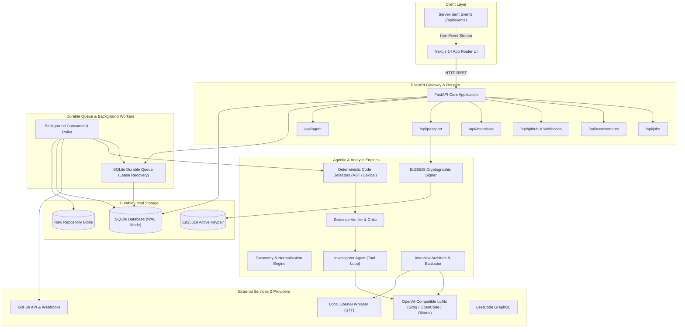
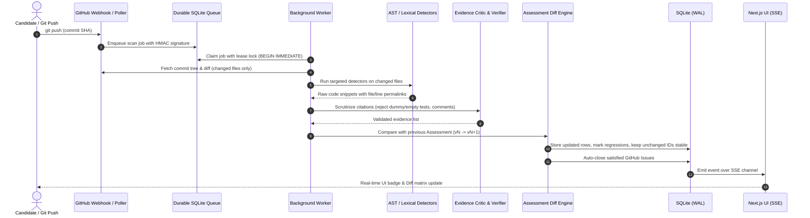

# AI Career Coach — Architecture & System Design

This document details the architectural design, bounded agent loop, deterministic evidence engine, data persistence, and security model of the **Agentic AI-Based Career Coach**.

---

## 1. High-Level System Architecture

The AI Career Coach pairs real job descriptions with real evidence from candidate GitHub repositories. It assesses technical competency without relying on mock data, hallucinated claims, or ungrounded evaluations.

---

## 2. Event-Driven Reassessment Architecture

A core capability of the architecture is **autonomous event-driven reassessment**. When candidate repositories receive new commits via GitHub webhook or SHA polling, the system performs an incremental diff assessment without rescanning untouched files.

---

## 3. Subsystem Breakdown

### 3.1. Code Analyzers (`backend/app/analyzers`)
- **Taxonomy Engine (`taxonomy.py`)**: Defines versioned canonical technical competencies (API backend, databases, caching, message queues, Docker, testing, CI/CD, architecture).
- **Python AST Analyzer (`pyast.py`, `detect_python.py`)**: Uses Python's native `ast` module to detect real route definitions, database queries, ORM usage, and non-trivial assertions. Ignores docstrings and comment blocks.
- **Lexical C-like Detectors (`detect_clike.py`, `lexer.py`)**: Comment-stripped pattern matching and bracket balancing for TypeScript, JavaScript, Go, Rust, Java, C#, and PHP.
- **Config & Manifest Detectors (`detect_config.py`, `libraries.py`)**: Inspects `Dockerfile`, `docker-compose.yml`, GitHub Actions workflows, `pyproject.toml`, `package.json`, and Terraform manifests to distinguish declared dependencies from active code.

### 3.2. Bounded Agent Runtime (`backend/app/agents`)
- **JD Extractor (`jd_extractor.py`)**: Extracts verbatim requirement quotes from job postings. Every extracted requirement must exist as an exact substring in the source text.
- **Evidence Critic (`evidence_verifier.py`)**: Deterministic and LLM critic pass that filters out shallow implementations (`assert True`, empty handlers, unexecuted SQL strings).
- **Investigator (`investigator.py`)**: Bounded agent loop that performs tool-based investigations on ambiguous code blocks, re-checking citations against pinned commits.
- **Interview Architect & Evaluator (`interview_architect.py`, `interview_evaluator.py`)**: Synthesizes custom mock interview questions targeting specific candidate gaps and evaluates candidate audio/text answers against real rubric items.
- **Code Defense (`code_defense.py`)**: Generates targeted cross-examination questions about candidate-authored code in their repositories.

### 3.3. Core Services (`backend/app/services`)
- **Durable Queue (`job_queue.py`)**: SQLite-backed queue with leasing, retry limits, automatic lease recovery, and zero external message broker requirements.
- **Repo Scanner (`repo_scanner.py`)**: Handles commit-pinned scanning, blob caching, branch HEAD tracking, and tree traversal.
- **Assessment Engine (`assessments.py`, `reassessment.py`)**: Computes requirement-by-requirement gap matrices, verdicts (`DEMONSTRATED`, `PARTIAL`, `NOT_DEMONSTRATED`), and incremental diffs.
- **Skill Passport (`passport.py`)**: Generates cryptographic Ed25519-signed JSON skill passports verifiable by third parties.
- **Gap-to-Proof Tasks (`gap_tasks.py`)**: Generates actionable, machine-verifiable GitHub issues with specific acceptance criteria to resolve detected skill gaps.

### 3.4. Background Worker (`backend/app/workers/worker.py`)
- Executes asynchronously outside the API request-response loop.
- Consumes queue jobs, handles heartbeat monitoring, and periodically polls configured repositories for new commits if webhooks are not publicly accessible.

---

## 4. SQLite Storage & Concurrency Model

All application data is persisted locally in `data/career_coach.db`:

- **WAL (Write-Ahead Logging)**: Enables concurrent reads while writes are active.
- **Immediate Transactions**: Durable queue claims use `BEGIN IMMEDIATE` to prevent race conditions across processes.
- **Foreign Key Enforcement**: `PRAGMA foreign_keys = ON` enforced on every connection.
- **Event Log Tail**: Client UI connects to SSE (`/api/events`) which tails the `event_log` table, eliminating IPC dependencies.
