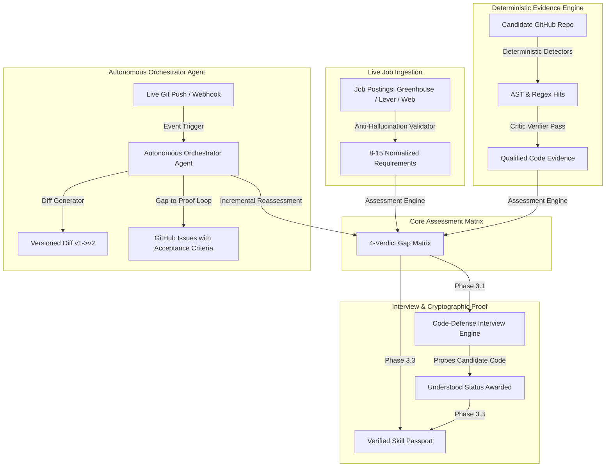

# AI Career Coach — System Architecture & Specification

An Autonomous AI Career Coach with live GitHub repository change detection, deterministic code detectors, critic verifier pass, Code-Defense interviews, and Verified Skill Passport.

---

## 🏗️ Visual System Architecture

---

## 🧩 Architectural Subsystems

### 1. Ingestion & Anti-Hallucination Validation (`backend/job_discovery.py`)
- Real job posting ingestion from Greenhouse, Lever, Adzuna, and public board APIs.
- Strict anti-hallucination substring validator: every requirement quote must match source text verbatim or be purged immediately.

### 2. Deterministic AST & Regex Detectors (`backend/detectors.py`)
- Native Python AST analysis targeting route handlers (FastAPI, Flask), relational database schemas/queries (SQLAlchemy, SQL queries), and unit test assertions (pytest, unittest).
- Comment and docstring stripper ensuring superficial mentions in comments or markdown files are never credited.

### 3. Critic & Verifier Pass (`backend/verifier.py`)
- Adversarial evaluation of detected snippets to filter out trivial stubs, `pass` blocks, and mock code.
- Assigns depth labels: `trivial`, `surface`, `working`, and `production`.

### 4. Autonomous Controller Agent (`backend/orchestrator.py`)
- Standing Goal: *"Keep this candidate's skill-gap assessment for the target role accurate and current."*
- Bounded execution loop: `observe -> plan -> act (tools) -> verify -> update memory -> report`.
- Streams agent thoughts, detector executions, and critic verdicts in real-time.

### 5. Live Git Engine & Reassessment Loop (`backend/git_engine.py`)
- Webhook receiver (`/api/git/webhook`) and background poller tracking real commit SHAs.
- Incremental reassessment triggers only for modified files, computing versioned diffs (`v1 -> v2`).

### 6. Code-Defense Interview Engine (`backend/interview_engine.py`)
- Synthesizes technical interview questions derived directly from candidate-authored code.
- Assesses comprehension, speech pace (WPM), filler frequency, and awards the **Understood** flag.

### 7. Verified Skill Passport (`backend/passport.py`)
- Cryptographically verifiable passport linking candidate accomplishments to verified commit SHAs, line numbers, and interview validation timestamps.
