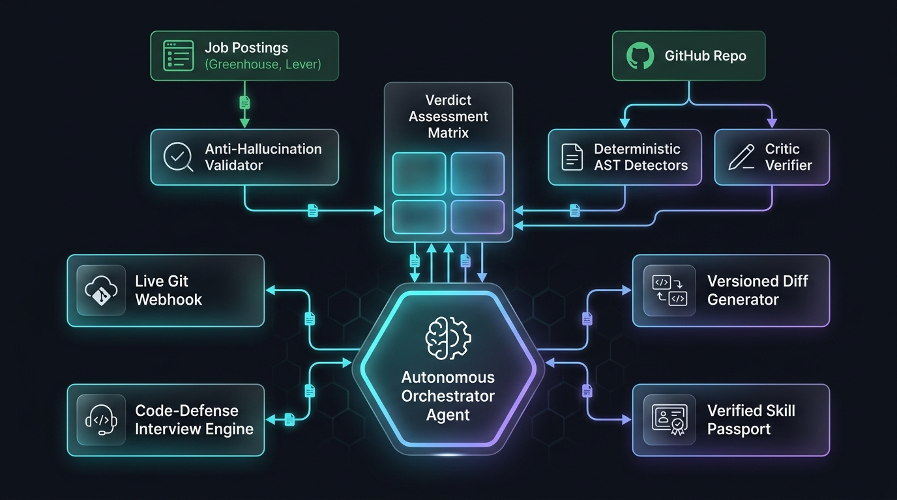
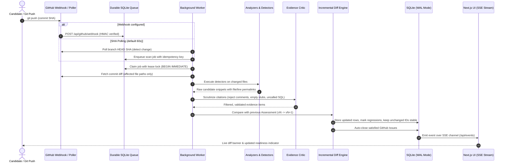

# AI Career Coach — System Architecture & Specification (W-PS-2)

An evidence-driven, autonomous AI Career Coach that compares **real job requirements** against **verifiable evidence in real GitHub repositories**, explains every gap with file/line/commit citations, reassesses automatically on git pushes, conducts candidate code-defense interviews, and issues Ed25519-signed Skill Passports.

**Zero Mock Data Policy**: Nothing is seeded or synthetic. Job postings originate from verbatim ATS/API text or user input. Code citations resolve to pinned commit SHAs on GitHub. Missing integrations surface explicit "not configured" states without fallback illusions.

---

## 🏗️ 1. Visual System Architecture

```mermaid
graph TB
    subgraph Client ["Client Layer (Next.js 14 App Router)"]
        UI["Next.js Web Interface (Dashboard, Gaps, Defense, Passport)"]
        SSE["Server-Sent Events Subscriber (/api/events)"]
        AudioRec["Local Audio Recorder (MediaRecorder API)"]
    end

    subgraph Gateway ["FastAPI Gateway & Modular Routers"]
        GW["FastAPI Core Application (Lifespan & CORS)"]
        R_Jobs["/api/jobs (Ingestion & Discovery)"]
        R_Assess["/api/assessments (Gap Matrix & Diffs)"]
        R_GH["/api/github (Repo Scopes & Webhooks)"]
        R_Interviews["/api/interviews (Mock Sessions & Rubrics)"]
        R_Proof["/api/proof (Tasks, Sandbox & Defense)"]
        R_Passport["/api/passport (Ed25519 Verification)"]
        R_Profile["/api/profile (Claims & LeetCode)"]
        R_Agent["/api/agent (Action Traces)"]
    end

    subgraph QueueWorkers ["Durable Queue & Async Processing"]
        Queue[("SQLite Durable Queue (Lease Recovery)")]
        Worker["Background Consumer & SHA Poller (worker.py)"]
    end

    subgraph Analyzers ["Deterministic Code Analyzers (backend/app/analyzers)"]
        Taxonomy["Taxonomy & Skill Normalization (taxonomy.py)"]
        PyAST["Python AST Engine (pyast.py, detect_python.py)"]
        Lexer["Comment-Stripped Lexer (lexer.py, detect_clike.py)"]
        Manifests["Config & Manifest Engine (detect_config.py, libraries.py)"]
        CallGraph["Static Reachability Index (call_graph.py)"]
    end

    subgraph Agents ["Bounded Agent Runtime (backend/app/agents)"]
        Orchestrator["Autonomous Orchestrator Agent (orchestrator.py)"]
        JDExtractor["Verbatim Substring Extractor (jd_extractor.py)"]
        Critic["Adversarial Evidence Critic (evidence_verifier.py)"]
        Investigator["Tool-Loop Code Investigator (investigator.py)"]
        InterviewArch["Interview Architect & Evaluator (interview_architect.py)"]
        CodeDefense["Code-Defense Cross-Examiner (code_defense.py)"]
    end

    subgraph Services ["Core Domain Services (backend/app/services)"]
        Scanner["Commit-Pinned Repo Scanner (repo_scanner.py)"]
        AssessServ["Assessment & Diff Engine (assessments.py, reassessment.py)"]
        PassportServ["Ed25519 Signer & Serializer (passport.py)"]
        GapTasks["Gap-to-Proof Issue Generator (gap_tasks.py)"]
        Sandbox["Containerized Code Sandbox (sandbox.py)"]
    end

    subgraph Integrations ["External Integrations & Fallbacks"]
        GH_API["GitHub REST / Raw Blobs / Webhooks"]
        LLM_Router["LLM Router (Groq / OpenCode / Ollama / Gemini)"]
        Whisper["Local OpenAI Whisper (STT)"]
        LeetCode_API["LeetCode GraphQL Endpoint"]
        Job_Boards["Greenhouse / Lever / Adzuna / SerpApi"]
    end

    subgraph Storage ["Durable Local Storage (data/)"]
        DB[("SQLite Database (WAL Mode, foreign_keys=ON)")]
        BlobCache[("Raw Repository Blob Cache")]
        KeyStore[("Ed25519 Keypair Store")]
    end

    UI -->|HTTP REST| GW
    AudioRec -->|Audio Blobs| GW
    SSE -.->|Live Event Stream| UI
    GW --> R_Jobs & R_Assess & R_GH & R_Interviews & R_Proof & R_Passport & R_Profile & R_Agent
    GW --> Queue
    Worker --> Queue
    Worker --> Scanner
    Scanner --> GH_API
    Scanner --> BlobCache
    Scanner --> Analyzers
    Analyzers --> Critic
    Critic --> Investigator
    Investigator --> LLM_Router
    Critic --> AssessServ
    AssessServ --> DB
    Queue --> DB
    Worker --> DB
    GW --> DB
    Worker -->|Tail event_log| SSE
    PassportServ --> KeyStore
    InterviewArch --> Whisper
    InterviewArch --> LLM_Router
    CodeDefense --> LLM_Router
    R_Jobs --> Job_Boards
    R_Profile --> LeetCode_API
```





---

## 🔄 2. Event-Driven Reassessment Architecture

The core operational feedback loop guarantees automated, continuous reassessment upon git activity with zero human re-triggering required:

```text
real JD ─▶ verbatim requirements ─▶ commit-pinned repo scan ─▶ critic ─▶ gap matrix (v1)
                                                    ▲                          │
          push ─▶ webhook (HMAC) / SHA poll ─▶ durable SQLite job ─▶ diff ─▶ affected rows only ─▶ v2 + diff
```

### Sequence Flow: Push to Incremental Diff



---

## 🧩 3. Architectural Subsystems Breakdown

### 3.1. Code Analyzers (`backend/app/analyzers`)
- **Taxonomy Engine (`taxonomy.py`)**: Canonical, versioned competency catalog mapping programming languages, database architectures, ORMs, cloud infrastructure, and CI/CD tools to normalized skill tags.
- **File Classifier (`files.py`)**: Filters lockfiles, minified bundles, vendored code, documentation, and compiler caches to ensure analysis is strictly bounded to candidate-written source code.
- **Python AST Engine (`pyast.py`, `detect_python.py`)**: Native Python `ast` traversal identifying route decorators (FastAPI, Flask, Django), database sessions (SQLAlchemy, psycopg2), and test assertions (`pytest.mark`, `unittest.TestCase`). Strips all comments and docstrings.
- **Lexical C-Like Detectors (`detect_clike.py`, `lexer.py`)**: Comment-stripped pattern matching and bracket-depth tracking across TypeScript, JavaScript, Go, Rust, Java, C#, PHP, and Ruby.
- **Manifest & Infrastructure Detectors (`detect_config.py`, `libraries.py`)**: Parses `Dockerfile`, `docker-compose.yml`, GitHub Actions workflow YAMLs, `pyproject.toml`, `package.json`, and Terraform files to clearly separate *declared dependencies* from *actively executed code*.
- **Static Reachability & Findings (`call_graph.py`, `findings.py`)**: Indexes function declarations and references across repository files to resolve inter-module reachability.

### 3.2. Bounded Agent Runtime (`backend/app/agents`)
- **Autonomous Orchestrator (`orchestrator.py`)**: Bounded execution loop maintaining continuous alignment between student evidence and role requirements: `observe -> plan -> act (tools) -> verify -> report`.
- **Verbatim JD Extractor (`jd_extractor.py`)**: Extracts 8-15 core requirements from job descriptions. Every extracted quote is strictly verified via substring containment against the raw input text; non-verbatim extractions are rejected immediately.
- **Evidence Critic (`evidence_verifier.py`)**: Adversarial validation layer that penalizes superficial implementations (empty functions, `pass`, `assert True`, unexecuted SQL strings) and assigns depth tiers (`trivial`, `surface`, `working`, `production`).
- **Investigator Agent (`investigator.py`)**: Re-checks ambiguous citations by retrieving raw commit blobs and testing whether candidate code satisfies requirement semantics.
- **Interview Architect & Evaluator (`interview_architect.py`, `interview_evaluator.py`)**: Generates JD-specific interview prompts focused specifically on candidate skill gaps, and grades spoken/written answers against rubric criteria.
- **Code Defense (`code_defense.py`)**: Generates targeted cross-examination questions derived from specific functions and files authored by the student to verify genuine understanding versus copy-pasting.

### 3.3. Core Domain Services (`backend/app/services`)
- **Repo Scanner (`repo_scanner.py`)**: Commit-pinned GitHub scanner with tree traversal, local content blob caching, and SHA pinning.
- **Assessment & Reassessment Engine (`assessments.py`, `reassessment.py`)**: Builds the 4-verdict gap matrix (`DEMONSTRATED`, `PARTIAL`, `NOT_DEMONSTRATED`, `CLAIMED_ONLY`) and computes atomic versioned diffs (`v1 -> v2`).
- **Durable Job Queue (`job_queue.py`)**: SQLite-backed persistent queue with lease locks, retry counters, crash recovery, and worker heartbeats.
- **Job Discovery & Parsing (`jobs.py`, `documents.py`)**: Handles live ATS ingestion (Greenhouse, Lever), job board aggregators (Adzuna, SerpApi), and local PDF/text resume parsing.
- **Profile Claims & Algorithmic Signals (`profile.py`, `insights.py`)**: Manages self-reported resume claims and queries public LeetCode GraphQL endpoints for algorithm signals.
- **Mock Interviews (`interviews.py`)**: Timed session runner coordinating audio capture, transcription, and feedback delivery.
- **Gap-to-Proof Tasks (`gap_tasks.py`)**: Generates machine-verifiable GitHub issues with explicit acceptance criteria to guide candidate proof generation.
- **Sandbox Runner (`sandbox.py`)**: Optional Docker container executor running automated test suites against student code.
- **Cryptographic Skill Passport (`passport.py`)**: Signs verified competency proofs with an Ed25519 private key, exporting standalone verifiable JSON artifacts.
- **Event Log & SSE Pub-Sub (`storage.py`, `events.py`)**: Unbuffered event bus broadcasting database changes to connected frontend clients without third-party brokers.

### 3.4. Background Worker Process (`backend/app/workers/worker.py`)
- Standalone long-running daemon decoupled from the FastAPI request/response lifecycle.
- Consumes queue tasks, tracks worker heartbeats, recovers expired task leases, and polls GitHub repository branch heads every 60 seconds.

---

## ⚖️ 4. Handling of Edge Cases & Judging Scenarios

| Scenario | System Defense & Deterministic Behavior |
| :--- | :--- |
| **Empty or Stub Tests** (`def test_x(): pass`, `assert True`) | Detected and rejected by `detect_python.py` / `evidence_verifier.py`. Test skill verdict remains `NOT_DEMONSTRATED`. |
| **SQL in Comments / Docstrings** | Excluded before AST parsing (`lexer.py` comment stripper). Only executable SQL/ORM calls are parsed. |
| **Declared But Uncalled Dependency** | Marked at most `PARTIAL` ("declaration only") by `detect_config.py`. Never marked `DEMONSTRATED`. |
| **Non-Code / Docs-Only Commit** | Analyzers recognize no code files were altered. Diff engine marks zero row alterations and preserves existing evidence IDs. |
| **Test Deletion / Regression** | Incremental scan identifies removed assertions. Verdict regresses from `DEMONSTRATED` to `NOT_DEMONSTRATED`, diff flagged as *regressed*. |
| **Duplicate / Out-of-Order Webhooks** | Enforced idempotency key per SHA in `job_queue.py`. Duplicate deliveries are dropped with status 200. |
| **LLM Hallucinated Quote** | Strict verbatim string search rejects any requirement quote not found verbatim in original posting. |
| **LLM Rate Limit or Downtime** | Automatic fallback across configured providers (OpenCode -> Groq -> Local Ollama -> Deterministic heuristic rules). |

---

## 🗄️ 5. SQLite Storage & Concurrency Architecture

All persistence is maintained locally inside `data/career_coach.db`:

- **WAL (Write-Ahead Logging)**: Configured on every connection to allow non-blocking concurrent reads while background worker writes occur.
- **Immediate Lease Locking**: Durable queue job claims use `BEGIN IMMEDIATE` under SQLite file lock to eliminate double-claim race conditions across workers.
- **Strict Data Integrity**: `PRAGMA foreign_keys = ON` and `PRAGMA busy_timeout = 10000` enforced on every database connection.
- **Format Consistency**: All timestamps are UTC ISO-8601 text, IDs are 32-character hex UUIDs, and complex attributes are strictly validated JSON text.
- **IPC-Free Reactivity**: The SSE endpoint (`/api/events`) tails the `event_log` SQLite table, delivering cross-process event notifications without Redis, RabbitMQ, or sockets.
