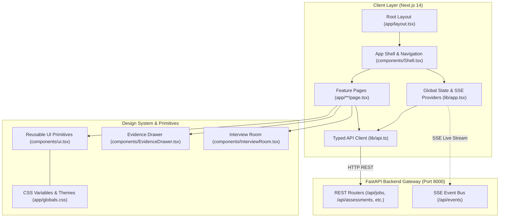

# AI Career Coach — Frontend Architecture & Component Design

This document details the frontend architecture, component hierarchy, design system tokens, state synchronization model, and page routing structure for the **Agentic AI-Based Career Coach** web client.

---

## 1. Architectural Overview

The Career Coach web client is built with **Next.js 14 App Router**, **TypeScript**, and **React 18**, leveraging a high-performance, zero-bloat vanilla CSS design system. It directly connects to the FastAPI backend over typed HTTP REST endpoints and consumes real-time telemetry via **Server-Sent Events (SSE)**.



---

## 2. Directory & Component Hierarchy

```text
frontend/
├── app/
│   ├── layout.tsx                     # Root HTML layout, font setup & Shell wrapper
│   ├── globals.css                    # Design tokens, themes (light/dark), and atomic utilities
│   ├── page.tsx                       # Overview: Readiness score & gap summary radar
│   ├── jobs/                          # Phase 1: Real JD Discovery & Target Extraction
│   │   ├── page.tsx                   # Job market search & scraped posting list
│   │   ├── [id]/page.tsx              # Deep-dive job detail & raw description viewer
│   │   └── target/page.tsx            # Active target JD and verbatim requirement quotes
│   ├── repos/                         # Phase 1: Candidate Repository Ingestion & Scope
│   │   ├── page.tsx                   # Repository selector, branch picker & analysis scopes
│   │   └── [scopeId]/page.tsx         # Detailed file tree & pinned commit inspection
│   ├── gaps/                          # Phase 1: Evidence Matrix & Verifiable Gaps
│   │   └── page.tsx                   # Interactive requirement-to-evidence matrix
│   ├── history/                       # Phase 1: Event-Driven Reassessment Diff Timeline
│   │   └── page.tsx                   # Commit-by-commit assessment diffs & regression alerts
│   ├── profile/                       # Phase 2: Candidate Signals & LeetCode Sync
│   │   └── page.tsx                   # Resume claims, PDF uploads, and LeetCode stats
│   ├── interview/                     # Phase 2: AI Mock Technical Interview Runner
│   │   ├── page.tsx                   # New interview session configurator & start prompt
│   │   ├── [id]/page.tsx              # Live mock interview room (Audio/STT + Text)
│   │   ├── [id]/report/page.tsx       # Graded rubric report & question-by-question critique
│   │   └── reports/page.tsx           # Past interview archive & performance metrics
│   ├── defense/                       # Phase 3: Code Defense Cross-Examination
│   │   └── page.tsx                   # Author verification challenges on student repo snippets
│   ├── tasks/                         # Phase 3: Actionable Gap-to-Proof Roadmap
│   │   └── page.tsx                   # GitHub Issue creator & machine-verifiable task tracker
│   ├── passport/                      # Phase 3: Cryptographic Skill Passport
│   │   └── page.tsx                   # Ed25519-signed passport viewer, export & proof JSON
│   ├── p/[artifactId]/page.tsx        # Public standalone verification page for signed artifacts
│   ├── activity/                      # System: Agent Execution Trace & Audit Trail
│   │   └── page.tsx                   # Live trace streaming, tool execution logs & step viewer
│   └── settings/                      # System: Integrations & Privacy Controls
│       └── page.tsx                   # LLM providers, GitHub tokens, webhook status & DB stats
├── components/
│   ├── Shell.tsx                      # Main application sidebar, top navigation & theme switcher
│   ├── ui.tsx                         # Atomic design components (Card, Badge, Button, Tabs, Metric)
│   ├── EvidenceDrawer.tsx             # Interactive slide-over drawer for inspecting code citations
│   ├── InterviewRoom.tsx              # Audio recorder, live speech-to-text, and question runner
│   └── Feedback.tsx                   # In-app verifier feedback and student correction modal
├── lib/
│   ├── api.ts                         # Strongly typed API client with custom error classes
│   └── app.tsx                        # Global AppState, SSE EventsProvider & Toast notification bus
├── next.config.js                     # Next.js bundler configuration & backend rewrites
├── package.json                       # Next 14, React 18, Lucide React dependencies
├── tsconfig.json                      # Strict TypeScript compiler options & `@/*` alias path
└── next-env.d.ts                      # TypeScript definitions for Next.js
```

---

## 3. Core Subsystems

### 3.1. Typed API Client (`lib/api.ts`)
- Configured with `NEXT_PUBLIC_API_BASE` (defaulting to `http://127.0.0.1:8000`).
- Provides strongly typed wrapper methods (`api.get`, `api.post`, `api.patch`, `api.del`, `api.form`).
- Handles `ApiError` instances with standardized status codes, user-facing error messages, recovery actions, and retry-after hints.
- Encapsulates domain interfaces: `Requirement`, `Evidence`, `AssessmentRow`, `AssessmentDiff`, `JobPosting`, `SkillPassport`, and `AgentAction`.

### 3.2. State Management & Real-Time SSE Stream (`lib/app.tsx`)
- **`AppStateProvider`**: Manages the current candidate context, selected active target job, analysis scope, and current assessment version.
- **`EventsProvider`**: Establishes an unbuffered `EventSource` connection to `GET /api/events` for real-time reactivity:
  - Automatically invalidates stale caches when background workers complete repository scans.
  - Displays instant toast notifications when autonomous re-assessments complete or new issues are created.
- **`ToastProvider`**: Queue-based notification system for success, warning, and critical error alerts.

### 3.3. Reusable UI Primitives (`components/ui.tsx`)
- High-contrast, theme-aware components that enforce a cohesive look and feel:
  - `Card`, `CardHeader`, `CardTitle`, `CardDescription`: Clean elevation containers.
  - `Badge`: Verdict badges (`DEMONSTRATED` [emerald], `PARTIAL` [amber], `NOT_DEMONSTRATED` [rose], `CLAIMED_ONLY` [sky]).
  - `Button`: Multiple variants (`primary`, `secondary`, `outline`, `ghost`, `danger`) with loading spinner integration.
  - `Metric`: Key performance indicator cards for readiness score, verified requirements count, and gap tasks open.
  - `EmptyState`: Contextual empty states with primary call-to-action buttons.

### 3.4. Interactive Evidence Inspector (`components/EvidenceDrawer.tsx`)
- Slide-over inspection drawer that allows users to click any requirement row in the matrix to view:
  - Pinned commit SHA permalink.
  - Exact file path and line range (`start_line` to `end_line`).
  - Extracted code snippet with lexical syntax highlighting.
  - Critic scrutiny verdict and detector confidence scores.

### 3.5. Audio & Text Interview Room (`components/InterviewRoom.tsx`)
- Real-time technical mock interview runner:
  - Dual response modes: candidate voice audio recording (via MediaRecorder API) or direct text transcription.
  - Dynamic countdown timer clamped to realistic interview answer durations (60–180s).
  - Real-time question navigation and automatic session grading trigger.

---

## 4. Visual Design System & CSS Architecture (`app/globals.css`)

The interface uses a curated CSS variable token design system with first-class **Dark** and **Light** modes:

| Token Category | Dark Mode Value | Light Mode Value | Purpose |
| :--- | :--- | :--- | :--- |
| `--bg` | `#0b0f17` (Deep Slate) | `#f8fafc` (Cool Off-White) | Viewport background |
| `--panel` | `#111827` (Card Surface) | `#ffffff` (Crisp White) | Cards, sidebars, modal surfaces |
| `--border` | `rgba(255, 255, 255, 0.08)` | `rgba(0, 0, 0, 0.08)` | Structural dividers & card outlines |
| `--primary` | `#3b82f6` (Vibrant Blue) | `#2563eb` (Deep Royal) | Primary actions & accent highlights |
| `--emerald` | `#10b981` | `#059669` | Demonstrated competency |
| `--amber` | `#f59e0b` | `#d97706` | Partial evidence |
| `--rose` | `#ef4444` | `#dc2626` | Skill gap / Missing proof |

- **Typography**: Clean system stack (`ui-sans-serif, system-ui, -apple-system, BlinkMacSystemFont, "Segoe UI", Roboto`) for crisp readability across mobile and desktop.
- **Glassmorphism**: Subtle backdrop blur on header panels and floating drawers (`backdrop-filter: blur(12px)`).
